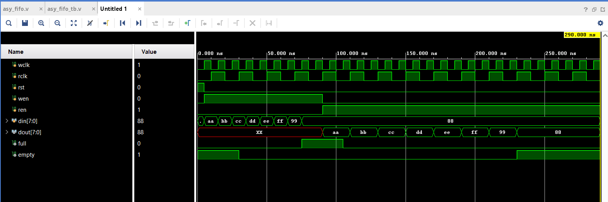

# Asynchronous FIFO Design Using Verilog HDL

## 📌 Project Overview

This project implements an 8-bit, 8-depth Asynchronous FIFO (First-In First-Out) using Verilog HDL.

An asynchronous FIFO is used to transfer data between two different clock domains. It uses independent read and write clocks to manage data storage and retrieval.

## ⚙️ Design Specifications

| Parameter       | Description                    |
| --------------- | ------------------------------ |
| FIFO Type       | Asynchronous FIFO              |
| Data Width      | 8 bits                         |
| FIFO Depth      | 8 locations                    |
| Write Clock     | Independent                    |
| Read Clock      | Independent                    |
| Pointer Width   | 4 bits                         |
| Reset           | Active-high asynchronous reset |
| Design Language | Verilog HDL                    |
| Simulation Tool | Xilinx Vivado                  |

## ✨ Features

- Independent read and write clock domains.
- 8-bit data input and output.
- 8 memory locations.
- Separate read and write operations.
- Read and write pointer management.
- FIFO full and empty status flags.
- Asynchronous reset.
- Testbench-based functional simulation.

## 📂 Repository Structure

```text
Asynchronous-FIFO-Verilog/
│
├── RTL/
│   └── asy_fifo.v
│
├── Testbench/
│   └── asy_fifo_tb.v
│
├── Simulation/
│   └── async_fifo_waveforms.png
│
└── README.md
```

## 🔬 Simulation and Verification

The FIFO design was simulated using independent write and read clocks.

The testbench writes the following hexadecimal data values into the FIFO:

`AA, BB, CC, DD, EE, FF, 99, 88`

The read operation retrieves the stored data in FIFO order.

### Simulation Waveform



## 📊 Observed Signals

| Signal | Description |
|--------|-------------|
| wclk   | Write clock |
| rclk   | Read clock |
| rst    | Reset signal |
| wen    | Write enable |
| ren    | Read enable |
| din    | 8-bit data input |
| dout   | 8-bit data output |
| full   | FIFO full indicator |
| empty  | FIFO empty indicator |

## 🛠️ Tools and Technologies

- Verilog HDL
- Xilinx Vivado
- RTL Design
- Digital Logic Design
- Functional Simulation

## 🎯 Learning Outcomes

- Understanding asynchronous FIFO architecture.
- Working with independent clock domains.
- Implementing read and write pointer logic.
- Understanding FIFO full and empty conditions.
- Writing Verilog testbenches.
- Analyzing simulation waveforms.

## 🚀 Future Improvements

- Implement Gray-coded read and write pointers.
- Improve clock-domain crossing synchronization.
- Verify FIFO operation with different clock frequencies.
- Perform additional corner-case testing.

## 👨‍💻 Author

**Jagadesh Reddy Kasani**

Aspiring Design Verification Engineer

[GitHub Profile](https://github.com/kasanijagadeshreddy-27)
